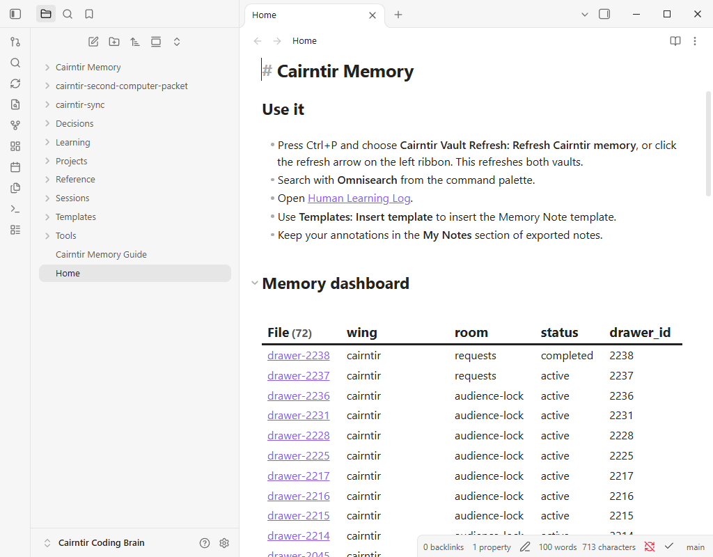
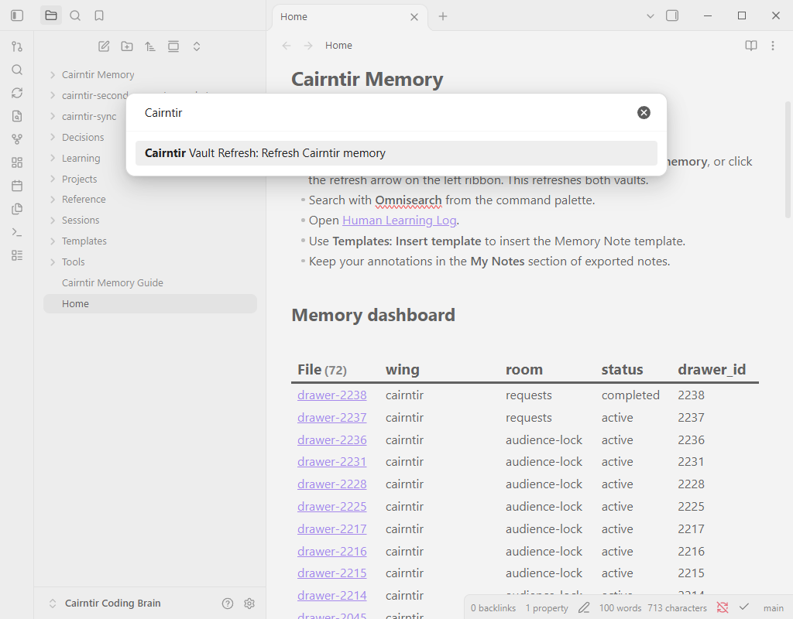
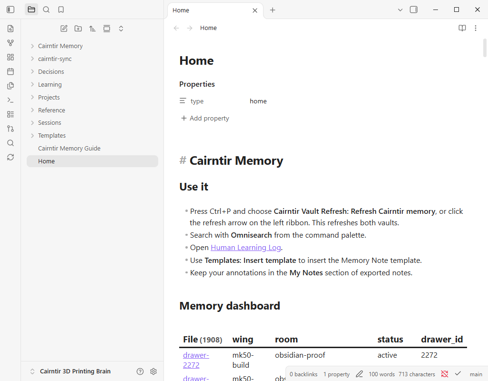

# How I use Obsidian and Cairntir together

Here is a look at how I use Cairntir with Obsidian for my coding and 3D-printing projects. Cairntir holds the memory, and Obsidian gives me a place to browse it alongside my project notes.

My coding vault brings exported memories into a linked dashboard, organized by project, topic, and status.

I use a local Cairntir Vault Refresh plugin to refresh both vaults from Obsidian's command palette.

My 3D-printing vault gives me another view of the memory for that work. These are screenshots from my own setup using Cairntir 1.14.1 and Obsidian 1.15.0.

## What would you use them for?

Coding and 3D printing are my examples. I would love to see what other people do with this combination: research notes, learning journals, creative projects, troubleshooting logs, or something I have not thought of.

If you try Obsidian and Cairntir together, share your setup, screenshots, or ideas. Everyone is welcome, whatever your experience level. If something is confusing or does not work, [open an issue](https://github.com/pnmcguire480/cairntir/issues). You do not need to know the cause or have a fix; feedback helps improve Cairntir.

*Captured November 17, 2026. Screenshots are unedited; personal notes were kept out of view.*
